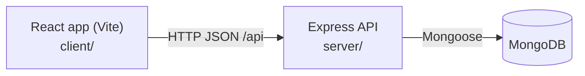
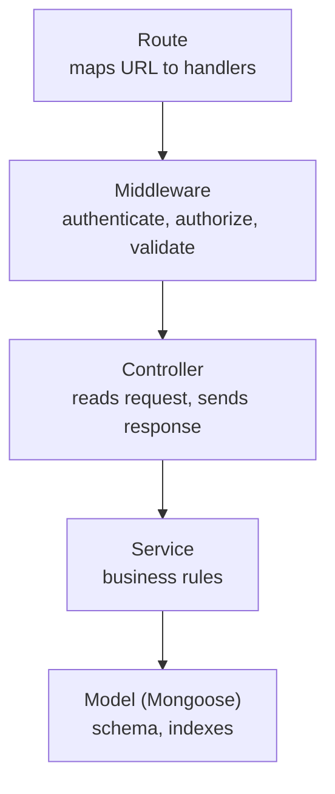
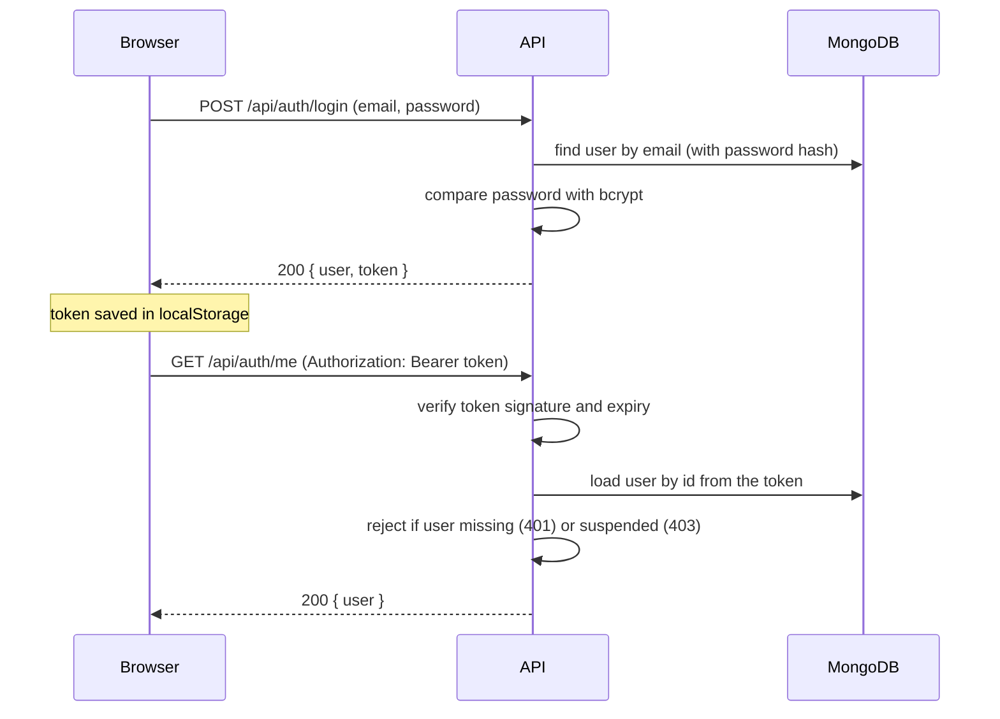

# Architecture

## Overview
CampusGig is a monolithic full-stack application in one repository.

## Backend layers
Each request passes through the same layers. Keeping them separate makes each piece easy to explain and test.

| Layer | Folder | Responsibility |
|---|---|---|
| Routes | `server/src/routes` | Only wire URLs to middleware and controllers. No business logic. |
| Middleware | `server/src/middleware` | Authentication, authorization, validation, rate limiting, error handling. |
| Controllers | `server/src/controllers` | Thin: take validated input, call a service, send `{ success, data }`. |
| Services | `server/src/services` | Business logic (register, login, update profile, statistics). |
| Models | `server/src/models` | Mongoose schemas, validation, indexes. |
| Validators | `server/src/validators` | zod schemas describing what each request may contain. |
| Utils / constants | `server/src/utils`, `constants` | Small shared helpers and fixed values (roles, statuses). |

## Login and protected-request flow

## Authorization order for a profile update
`PUT /api/students/:id` runs these checks in order, and stops at the first failure:
1. `authenticate` - valid token and active account (401 / 403).
2. `authorizeRoles(STUDENT)` - only students may use this endpoint (403).
3. validate `:id` format (400).
4. `requireSelf('id')` - the id must be the caller's own (403).
5. validate the body with a strict schema (400).

## Frontend structure
| Folder | Purpose |
|---|---|
| `pages/` | One component per screen, grouped by role. |
| `layouts/` | `PublicLayout` (header/footer for visitors) and `AppLayout` (dashboard shell). |
| `components/ui/` | Reusable building blocks: Button, FormField, Alert, loaders, empty and error states. |
| `context/AuthContext.jsx` | Holds the logged-in user, restores the session from the saved token, exposes login/register/logout. |
| `services/` | All HTTP calls. `apiClient.js` adds the token and converts failures into `ApiError`. |
| `routes/` | `ProtectedRoute` and `GuestRoute` decide who can open a page. Real protection is on the server. |
| `hooks/` | `useAuth`, and `useAsync` (loading / error / data for any async call). |

## Planned evolution (Version 2)
| Version 1 piece | Grows into |
|---|---|
| Database-backed messaging | Socket.IO real-time chat on the same conversation and message models |
| Basic profile | Verification and trust badges |
| Search and filters | AI job recommendations and candidate matching |
| Job and application workflow | Payments and escrow |
