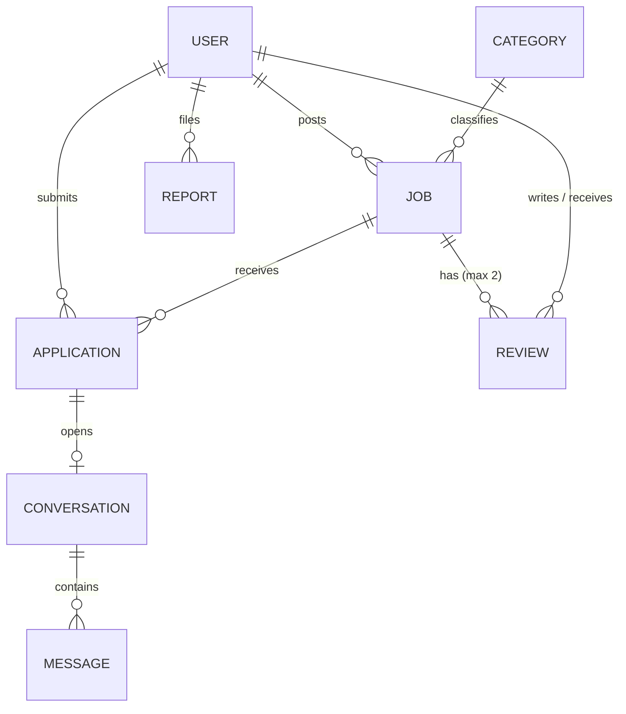

# Database design

MongoDB with Mongoose. All collections are designed now so later increments do not force rewrites.
**Status:** users, categories, jobs, applications (Increments 1-4) and reviews, conversations, messages, reports (Increment 5) are implemented.

## users (implemented)
| Field | Type | Notes |
|---|---|---|
| `name` | String, 2-80 | Person's name (poster's contact name too) |
| `email` | String, unique, lowercase | Unique index |
| `passwordHash` | String, `select:false` | Never returned by queries or JSON |
| `role` | `STUDENT` / `POSTER` / `ADMIN` | `immutable` |
| `status` | `ACTIVE` / `SUSPENDED` | Checked on every authenticated request |
| `location`, `bio` | String | `bio` is the student bio or poster description |
| `studentProfile` | `{ university, department, skills[], availability, experience }` | Only on students |
| `posterProfile` | `{ organizationType, organizationName, website }` | Only on posters |
| `ratingSummary` | `{ average, count }` | Derived; written only by the review module |
| `lastLoginAt`, `createdAt`, `updatedAt` | Date | |

Virtual `profileCompletion` (percentage + missing items) is included in the owner's JSON only.
**Why embedded profiles:** see DECISIONS D15.

## categories (implemented, Increment 3)
`name` (unique), `slug` (unique), `isActive`. A category with jobs is deactivated, never deleted (deactivation itself is an admin action, planned for Increment 6; the field and the rule already exist).

## jobs (implemented, Increment 3)
`poster` (ref User, immutable), `title`, `description`, `category` (ref), `skills[]`, `budget`, `duration`, `location`, `workType` (`REMOTE`/`ON_SITE`/`HYBRID`), `deadline`, `status` (`OPEN`/`CLOSED`/`IN_PROGRESS`/`COMPLETED`/`CANCELLED`), `acceptedApplication` (ref, set in Increment 4), `removedByAdmin` (Boolean, used from Increment 6).
Indexes: `{ status, createdAt }`, `{ category }`, `{ poster, createdAt }`, text index on `title` and `description`.
`IN_PROGRESS` and `COMPLETED` are not reachable yet (they require the application accept/complete flow, Increments 4-5); `OPEN`, `CLOSED`, and `CANCELLED` are fully working now.

## applications (implemented, Increment 4)
`job`, `student` (both immutable), `coverMessage` (10-1000), `proposedAmount` (optional), `status` (`PENDING`, `SHORTLISTED`, `ACCEPTED`, `REJECTED`, `WITHDRAWN`, `COMPLETED`), `withdrawnBy` (`STUDENT` or `POSTER_CANCELLED`, only when withdrawn). `COMPLETED` is set in Increment 5.
**Unique index `{ job, student }`** - one application per student per job, ever.

## reviews (implemented, Increment 5)
`job`, `application`, `reviewer`, `reviewee`, `rating` (1-5 integer), `comment`, `removedByAdmin`.
**Unique index `{ job, reviewer }`** - one review per direction. Index `{ reviewee, createdAt }` for profile listings. `reviewer`/`reviewee` are set by the server from the job, never from the request.

## conversations and messages (implemented, Increment 5)
`conversations`: `job`, `application` (unique), `poster`, `student`, `lastMessageAt`.
`messages`: `conversation`, `sender`, `body` (1-2000), `readAt` (null until the other person opens the thread). Index `{ conversation, createdAt }`.

## reports (implemented, Increment 5)
`reporter`, `targetType` (`JOB`/`USER`), `targetJob` or `targetUser`, `reason` (fixed list), `description`, `status` (`PENDING`/`REVIEWING`/`RESOLVED`/`DISMISSED`), `resolvedBy`, `resolutionNote`, `resolvedAt`.
A partial unique index (`isActive: true`) prevents two active reports by the same reporter against the same target. `isActive` is derived from `status` in a `pre('save')` hook, so Increment 6 must change report status with `document.save()`, not `updateOne`.

## Duplicates are stopped twice
Business rules are checked in services (friendly error messages), and unique indexes in MongoDB guarantee correctness even if two requests arrive at the same moment.
