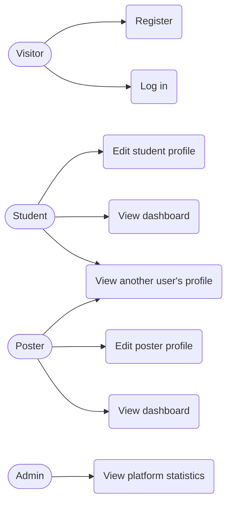
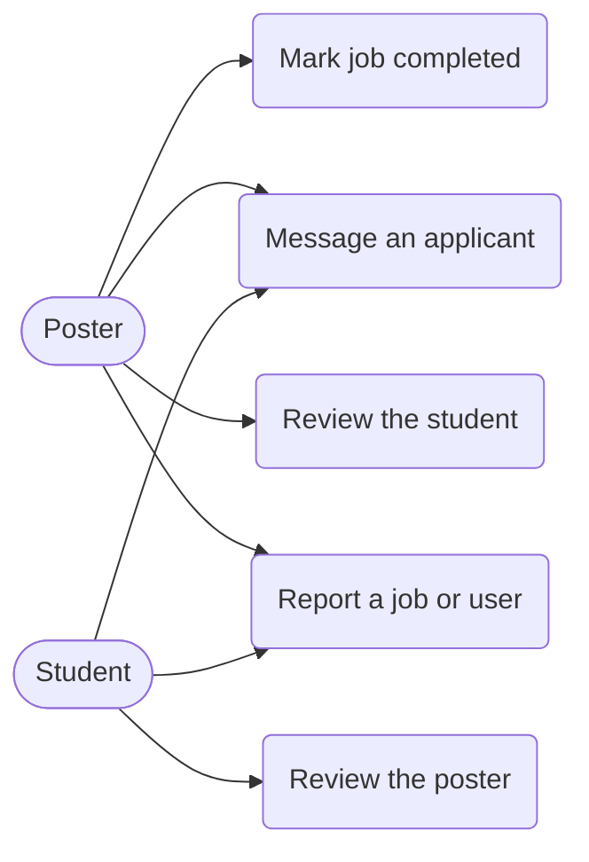
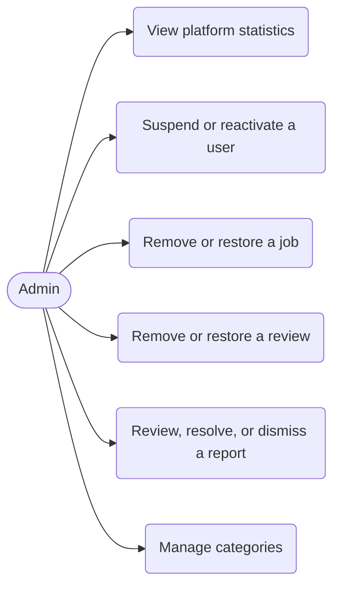

# Software Requirements Specification (foundation)

Project: CampusGig V1 · Team CodeConnect · BUBT · SOW #001 (16 Sep 2026 – 15 Dec 2026) · Incremental Model

## 1. Purpose and problem statement
University students need flexible, safe, short-term work. People and organizations that need small tasks done have no trusted place to find students. CampusGig is a web marketplace that connects both sides and adds trust through profiles, an application workflow, two-way reviews, reporting, and admin moderation.

## 2. Objectives
1. Let students discover and apply for short-term jobs.
2. Let posters publish jobs, evaluate applicants, and hire exactly one student per job.
3. Build trust through profiles, reviews, reports, and moderation.
4. Provide a maintainable base that Version 2 can extend (payments, real-time chat, verification, recommendations).

## 3. Scope
**In Version 1:** authentication, role-based authorization, profiles, job marketplace, applications, reviews, basic (non-real-time) messaging, reporting, admin panel.
**Out of scope (Version 2+):** payments and escrow, real-time chat, identity verification and trust badges, AI recommendations, analytics, mobile app, production-scale deployment.
CampusGig V1 gives foundational trust and moderation tools. It does not claim to prevent scams completely.

## 4. Users
| Role | Description |
|---|---|
| Student | University student seeking flexible work |
| Poster | Individual, business, or organization hiring for a short task |
| Admin | Platform moderator; created only by the seed script |

## 5. Functional requirements
Status shows the increment in which each requirement is delivered. "Built" means code is written; see PROGRESS.md for what has been verified.

| ID | Requirement | Increment | Status |
|---|---|---|---|
| FR-01 | A visitor can register as Student or Poster; email is unique | 2 | Built |
| FR-02 | A user can log in and out; sessions persist across page reloads | 2 | Built |
| FR-03 | Passwords are stored only as hashes | 2 | Built |
| FR-04 | Backend enforces role-based access; frontend routes are guarded for usability | 2 | Built |
| FR-05 | A suspended user cannot log in and existing tokens are rejected | 2, 6 | Built (the suspend action is in the admin panel) |
| FR-06 | Students maintain a profile (university, department, location, bio, skills, availability, experience) | 2 | Built |
| FR-07 | Posters maintain a profile (name, organization details, description, location, website) | 2 | Built |
| FR-08 | Each role has a dashboard; profiles show completeness and rating summary | 2 | Built |
| FR-09 | Posters create, edit, close, cancel, and delete jobs under the job status rules | 3 | Built |
| FR-10 | Anyone browses, searches, filters, sorts, and paginates jobs and opens job details (public pages) | 3 | Built |
| FR-11 | Students apply once per open job; posters shortlist, accept, or reject; students can withdraw | 4 | Built |
| FR-12 | Accepting an application starts the job and rejects all other pending applications | 4 | Built |
| FR-13 | Posters mark jobs complete or cancel them | 5 | Built (tests written, not yet run) |
| FR-14 | The poster and accepted student review each other once after completion | 5 | Built (tests written, not yet run) |
| FR-15 | Participants exchange messages within a conversation tied to a job | 5 | Built (tests written, not yet run) |
| FR-16 | Users report jobs or users; admins review, resolve, or dismiss reports | 5-6 | Built (tests written, not yet run) |
| FR-17 | Admins view statistics, suspend/reactivate users, remove jobs and reviews, manage categories | 6 | Built (tests written, not yet run) |

## 6. Non-functional requirements
| ID | Requirement |
|---|---|
| NFR-01 Security | Hashed passwords, signed tokens, backend authorization, input validation, helmet, CORS, rate limiting, no secrets in source control |
| NFR-02 Validation | Every input is validated on both the frontend and the backend; the backend is authoritative |
| NFR-03 Usability | Consistent layout, clear messages, loading, empty, and error states on every data screen |
| NFR-04 Responsiveness | Works on desktop, tablet, and mobile without horizontal page scroll |
| NFR-05 Accessibility | Semantic HTML, labelled fields, keyboard operation, visible focus, reduced-motion support |
| NFR-06 Maintainability | Layered backend, small modules, consistent naming, documented decisions |
| NFR-07 Testability | Application separated from server start-up so API tests run without a network port |
| NFR-08 Extensibility | Data model and API designed up front for Version 2 features |

## 7. Business rules
Implemented as decided in the project brief; the full list and any clarifications are in DECISIONS.md. Key rules: one role per user; one application per student per job; accepting an application rejects the others and starts the job; reviews only after completion, once per direction; suspended users are blocked immediately and hidden from the platform.

## 8. Use cases (Increments 1-2)

Job, application, review, messaging, reporting, and moderation use cases are added with their increments.

## 9. User stories (Increments 1-2, 5)
- As a student, I want to register and keep a profile of my skills so posters can trust me.
- As a poster, I want to describe my organization so students know who is hiring.
- As a user, I want to stay logged in after refreshing the page.
- As an admin, I want to see how many students and posters have joined.
- As the platform owner, I want a suspended account to be blocked immediately.
- As a poster, I want to mark a job completed so the student can be reviewed and the work is on record.
- As a student or poster, I want to review the other person once after a completed job so future users can trust them.
- As a shortlisted student, I want to message the poster to clarify details before accepting.
- As a user, I want to report a suspicious job or person so admins can look into it.

## 10. Use cases (Increment 5)

- As an admin, I want to suspend an account that breaks the rules and reactivate it later.
- As an admin, I want to remove a harmful job or an unfair review, and restore it if I was wrong.
- As an admin, I want to see open reports, act on them, and close them with a note.
- As an admin, I want to add, rename, and deactivate job categories.

## 11. Use cases (Increment 6)

